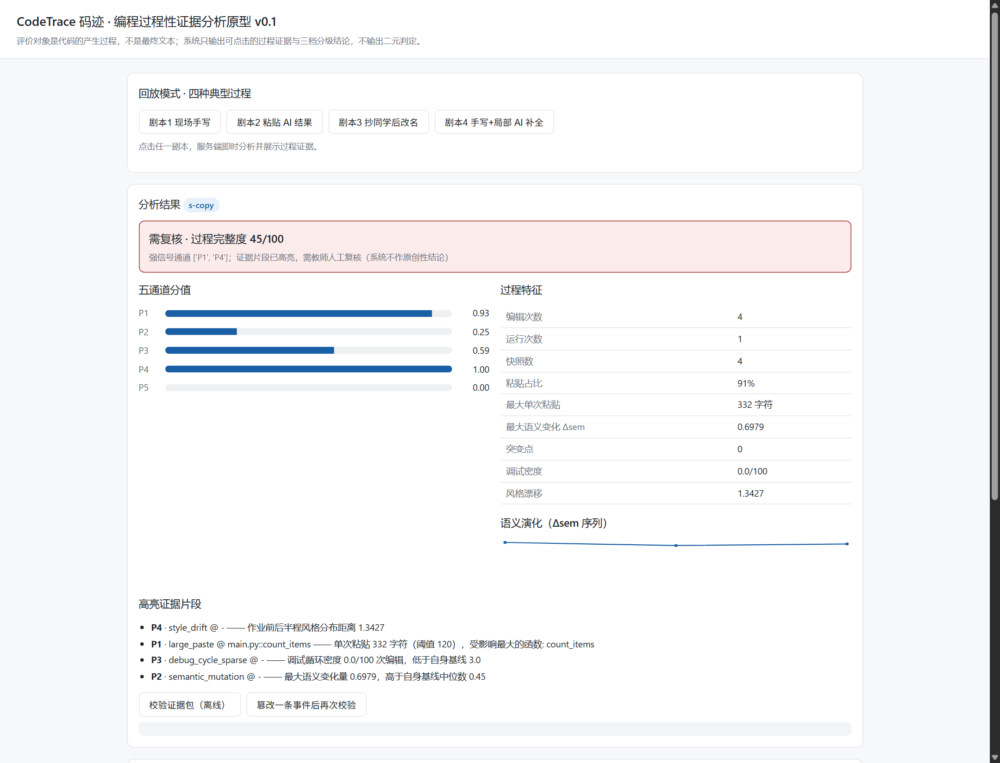

# CodeTrace 码迹 v0.1.0

[](https://github.com/W-Y-Chen/codetrace/actions/workflows/ci.yml)
[](LICENSE)
[](https://www.python.org/)
[-brightgreen.svg)](#一快速开始零第三方依赖)
[](CONTRIBUTING.md)



> 截图由 `python -m codetrace.server --port 8765` 真实运行后截取，未做数据修饰。

> 演示视频（3 分钟）｜ 发布计划见 [`docs/launch-plan.md`](docs/launch-plan.md)

面向高校编程教学的**过程性原创性判定与编程能力画像**系统原型。
评价对象是**代码的产生过程**，不是最终文本；系统只输出可点击的过程证据与三档分级结论，**不输出二元"作弊/未作弊"判定**。

完整的方案文档（技术方案、评测方案与竞赛申报材料）**不放在开源仓库内**，
避免内部材料与开源代码混在一起。需要看完整方案可联系作者。

---

## 一、快速开始（零第三方依赖）

v0.1 **只使用 Python 标准库**，无需 pip install，Python 3.9+ 即可运行。

```bash
# 1) 跑通四个演示剧本（打印完整过程证据报告）
python scripts/run_demo.py

# 2) 运行测试（46 项，实测）
python -m pytest -q

# 3) 生成样例事件文件到 data/samples/
python scripts/gen_samples.py

# 4) 启动演示服务，浏览器打开 http://127.0.0.1:8765
python -m codetrace.server --port 8765
```

运行测试（零依赖，Python 3.9+）：

```
python -m pytest -q
```

> 注：若使用虚拟环境 / 隔离环境，请用该环境的 python 执行；不要照搬他人机器的绝对路径。

---

## 二、当前实测结果（`scripts/run_demo.py` 真实输出）

| 剧本 | P1 粘入 | P2 突变 | P3 调试 | P4 风格 | P5 需求 | 结论档位 | 完整度 |
|---|---|---|---|---|---|---|---|
| 剧本1 现场手写 | 0.00 | 0.02 | 0.00 | 0.01 | 0.00 | **无异常** | 100/100 |
| 剧本2 粘贴 AI 结果 | **1.00** | 0.00 | 0.59 | 0.00 | 0.00 | **需复核** | 68/100 |
| 剧本3 抄同学后改名 | **0.93** | 0.25 | 0.59 | **1.00** | 0.00 | **需复核** | 45/100 |
| 剧本4 手写+局部 AI 补全 | 0.64 | 0.02 | 0.00 | 0.02 | 0.00 | **建议关注** | 86/100 |

关键验证点：

- **剧本1 不被误判** —— 对应方案 §8 的第一指标 FPR（原型级验证）
- **剧本4 只高亮局部** —— 有 AI 补全但整体手写，仅 P1 轻度偏离，进入"建议关注"而非"需复核"，证明系统**不因为局部使用工具就判全篇异常**
- 证据包离线校验：原始包 `ok=true`；篡改第 2 条事件后 `ok=false` 且 `first_bad_index=2`

> ⚠️ 以上为**模拟数据**的原型验证结果，**不是真实评测指标**。真实指标须按方案 §8 采集 30 人 × 6 题 × 3 种方式的对照数据集后实测。未实测不得对外发布。

---

## 三、目录结构

```
codetrace/
├── codetrace/
│   ├── events.py      结构化事件模型 + 规范化序列化（哈希链的前提）
│   ├── chain.py       链式摘要 / 增量 Merkle / 证据包导出与离线校验
│   ├── ted.py         Zhang-Shasha 树编辑距离（纯 Python 自研）+ 超规模降级
│   ├── astutil.py     AST 解析、函数级子树、风格特征
│   ├── evolution.py   代码语义演化图 + 分层语义差异度量 Δsem
│   ├── channels.py    P1–P5 五通道打分与证据条目
│   ├── baseline.py    自适应基线（学生自身历史）+ 冷启动回退
│   ├── decision.py    证据融合 + 三档分级结论（非二元约束）
│   ├── pipeline.py    端到端编排
│   ├── storage.py     SQLite 持久化
│   ├── simulate.py    四种典型过程的确定性模拟器
│   └── server.py      零依赖 HTTP 服务 + 接口
├── web/index.html     演示页面（原生 JS，回放模式 + 录制模式）
├── tests/             46 项测试（实测通过）
├── scripts/
│   ├── run_demo.py    一键跑通四个剧本
│   └── gen_samples.py 生成样例事件文件
└── data/samples/      样例事件（JSON）
```

---

## 四、核心实现说明

### 分层语义差异度量（创新一的关键工程点）

```python
# evolution.py
if a.funcs or b.funcs:            # 函数级：精确 Zhang-Shasha 树编辑距离
    d, degraded = layered_distance(a.funcs[name], b.funcs[name], max_nodes=300)
else:                             # 文件级：退化为整树比较
# ted.py
def layered_distance(a, b, max_nodes=300):
    if node_count(a) > max_nodes or node_count(b) > max_nodes:
        return multiset_distance(a, b), True      # 降级：线性复杂度
    return tree_edit_distance(a, b), False
```

把精确树编辑距离**限制在函数级子树**（通常数十至数百节点），超规模自动降级为节点多重集差异 —— 这是方案中可论证的技术效果：在保持定位精度的同时把差异计算规模从文件级降到函数级。

### 非二元结论约束（架构层硬约束）

```python
# decision.py
FORBIDDEN_FIELDS = {"is_cheating", "cheating", "ai_generated", "plagiarism", ...}

def validate(self):
    for name in FORBIDDEN_FIELDS:
        if hasattr(self, name):
            raise AssertionError(f"Verdict 禁止包含二元判定字段: {name}")
```

由 `Verdict.validate()` 与 `tests/test_decision.py` 双重保证，任何返回路径都不得产出二元判定。

### 防篡改存证（创新二）

```
h_0 = SHA256("codetrace-chain-v1|{session_id}|{nonce}")
h_i = SHA256(h_{i-1} || canonical_json(event_i))
```

每 32 条事件构建增量 Merkle 树，根锚定外部时间戳；证据包**自包含**，可在断网环境独立校验，篡改可定位到首个不一致位置（已实测）。

---

## 五、HTTP 接口

| 方法 | 路径 | 说明 |
|---|---|---|
| GET | `/` | 演示页面 |
| GET | `/api/health` | 健康检查 |
| GET | `/api/demo` | 四个剧本的结论摘要 |
| GET | `/api/demo/{key}` | 指定剧本的完整分析（含证据包、演化序列） |
| POST | `/api/analyze` | 即时分析（body: `{session_id, events, problem, history}`） |
| POST | `/api/sessions` | 保存并分析 |
| GET | `/api/sessions` | 会话列表 |
| GET | `/api/sessions/{id}/report` | 分析报告 |
| GET | `/api/sessions/{id}/package` | 证据包 |
| POST | `/api/verify` | 离线校验证据包 |

`key` 取值：`handwrite` / `paste_ai` / `copy_classmate` / `local_ai_assist`

---

## 六、已知局限（诚实清单）

1. **只支持 Python**。v0.1 用标准库 `ast` 解析；多语言（tree-sitter）为二期。
2. **P5 为词法近似实现**，未使用语义向量模型（`bge-small-zh-v1.5` + FAISS 为可选模块）。
3. **基线为冷启动全局值**。`baseline.py` 中的 `GLOBAL_BASELINE` 是设计假设值，**必须用真实采集数据重新标定**后才能用于正式评估。
4. **无真实过程数据**。当前全部为模拟器数据，仅验证链路与指标口径，不能证明检测效果。
5. **异机编写后逐字重敲无法检出**。若学生在另一台设备完成代码后逐字重新输入，系统只能看到"一次写对"的手写假象——这是数据最小化（不采代码全文）的固有代价，必须向使用者明示。
6. **服务为单进程 `http.server`**，仅适合演示，生产应替换为 FastAPI/Uvicorn。
7. **未实现**能力画像、申诉工作流、教师复核界面、VS Code 采集插件（均属完整版范围，见方案 §5）。

---

## 七、下一步（按方案 §7 里程碑）

| 优先级 | 事项 | 说明 |
|---|---|---|
| P0 | 采集真实对照数据 | 30 人 × 6 题 × 3 方式，同时标定 `GLOBAL_BASELINE` |
| P0 | 接 tree-sitter | 支持 Java/C/C++，接口保持不变 |
| P1 | 替换 FastAPI + React | 现为 stdlib http.server + 原生 JS，便于快速验证；正式版替换 |
| P1 | 实现申诉闭环与复核工作流 | 对应创新二的完整形态 |
| P2 | VS Code 采集插件 | 脱离 Web IDE 场景 |
| P2 | P5 语义版（句向量） | 需引入 sentence-transformers |

**替换 FastAPI/React 不影响核心算法模块**——`codetrace/` 下的算法层与传输层是解耦的。
